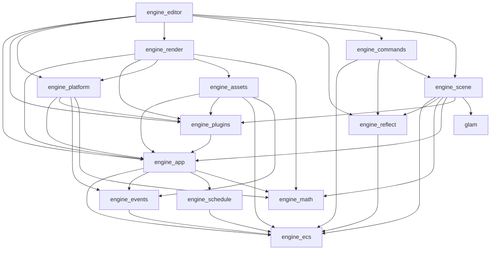

# Voxelworks Engine Architecture

The workspace is organized as a small engine core, optional plugins, sample
applications, and the STUDS game. Engine crates do not depend on game code.
`tools/allowed_deps.toml` is the machine-checked source for direct dependency
policy; run `python tools/check_deps.py` after changing a manifest.

## Repository layout

| Path | Contents | Package prefix |
| --- | --- | --- |
| `crates/` | Engine core: foundations, runtime, scene and rendering contracts, editor | `engine_*` |
| `plugins/` | Optional domain behavior installed into an `App` | `plugin_*` (folder name omits the prefix: `plugins/physics` is `plugin_physics`) |
| `examples/` | Small engine-only applications built on the ECS engine | none |
| `games/` | Games composed from the engine and plugins | none |
| `engine/` | **Legacy** `voxelworks-*` crates, kept only for `games/studs`; scheduled for deletion | `voxelworks-*` |
| `docs/`, `tools/`, `assets/` | Plans and decisions, dependency policy tooling, engine sample assets | |

New code never goes into `engine/`. Nothing outside `engine/` and `games/studs`
may depend on a `voxelworks-*` crate, and `tools/check_deps.py` fails the build if it does.

## Dependency graph

Arrows point from a crate to what it may depend on (the full allowlist is in
`tools/allowed_deps.toml`). Plugins and examples sit above this graph and
depend only on `engine_*` crates and, where listed, on other plugins.

## Which rendering crate is which

The names are close, so for the record:

| Package | Role |
| --- | --- |
| `engine_render` | Backend-neutral frame/draw contracts, resource-validated render graph, CPU presenter and optional wgpu context. Owns no scene knowledge. |
| `plugin_rendering` | Voxel scene/material data, CPU/GPU voxel raycasters, and the ECS bridge. Its `cpu` and `gpu` features are independently selectable; GPU mode uses offscreen rendering/readback. |
| `plugin_render3d` | Native-surface indexed/instanced mesh renderer with ECS extraction, depth buffering, metallic-roughness PBR, HDR tone mapping, directional shadows, frustum culling, glTF assets and greedy voxel mesh support. |

## Layers and responsibilities

| Layer | Packages | Does not do |
| --- | --- | --- |
| Foundations | `engine_math`, `engine_ecs`, `engine_events`, `engine_schedule` | Platform I/O, rendering, or gameplay |
| Runtime | `engine_app`, `engine_plugins`, `engine_platform`, `engine_assets` | Game-specific rules or GPU scene extraction |
| Scene and rendering contracts | `engine_reflect`, `engine_scene`, `engine_render`, `engine_commands`, `engine_editor` | Game assets, gameplay, or automatic parallelism |
| Plugins | `plugin_voxel`, `plugin_physics`, `plugin_animation`, `plugin_audio`, `plugin_rendering`, `plugin_editor_tools` | Owning the app loop or game state |
| Applications | `examples/*`, `games/studs` | Being dependencies of engine crates |

The permitted package edges are listed in `tools/allowed_deps.toml`. Math and
ECS are leaves; schedule/events build on ECS; app builds on those foundations;
platform, assets, scene, and rendering build on app contracts; plugins add
reusable domain behavior; games compose plugins.

## Frame order and plugins

`App::update` advances `Time`, then runs `First`, `PreUpdate`, zero or more
`FixedUpdate` steps, `Update`, `PostUpdate`, `Render`, and `Last`, in that
order. The fixed-step loop is capped at eight steps per frame. `Startup` and
`Shutdown` run once. Headless runs use a virtual 60 Hz delta.

Plugins are added in dependency order. Adding a plugin validates its declared
dependencies and unique name, calls `build`, and records it in `Plugins`;
`finish` hooks run when the app is built. Systems run serially in deterministic
stage order. A plugin should declare its dependencies, install resources, and
register systems in the appropriate stages.

## Writing a plugin or game

A plugin implements `engine_plugins::Plugin`, names its required plugins, and
adds reusable engine behavior. A game owns its content and gameplay, installs
the needed plugins, and adds game-specific systems or a compatibility bridge.
Keep dependencies from engine/plugin packages to game packages out of the
workspace.

## Current limits and migration state

- Systems run serially; system parameter injection is not implemented.
- Asset loading is synchronous and handles are weak.
- The render graph validates named-resource dependencies and orders native window frame passes, but is not yet a transient resource allocator, async scheduler, or GPU profiler.
- The ECS rendering bridge still supports the legacy CPU/offscreen-GPU voxel path. Separately, `plugin_voxel` can now greedily mesh chunks and `plugin_render3d` can draw `VoxelMeshInstance3D` directly on the native wgpu surface. STUDS has not yet migrated to that path; see phase 7 in `docs/RENDERER_PLAN.md`.
- `WinitRunner` must create the `softbuffer` CPU presenter only after `WindowFrame`
  contains a complete non-empty image. `PlatformPlugin` registers the resource for every
  app, including GPU-only apps; resource presence alone must not create a CPU surface for
  an HWND already used by `wgpu`, because competing native surfaces can crash on shutdown.
- The editor has no text input and is compiled only with its `editor` feature
  in debug builds. The glyph table limits available UI characters.
- Local 2D/voxel transforms and 3D quaternion transforms share the same entity hierarchy; their global transforms are recomputed each `PostUpdate` (dirty tracking is not implemented). `plugin_render3d` consumes `GlobalTransform3D`.
- `examples/scene_hierarchy_3d` demonstrates this `Transform3D` parent-child composition in the GPU mesh renderer and reports runtime diagnostics for global transform propagation.
- STUDS uses `engine_app::App`, `WinitRunner`, and the platform/scene/rendering/audio/game
  plugins. Live gameplay uses `MazeResource` and `RunState` resources plus `Player`, `Enemy`,
  and `PagePickup` entities, advanced by dedicated schedule systems. `Game` remains a
  compatibility/domain facade rather than a runtime resource. The game can select CPU or
  offscreen GPU voxel rendering through `--renderer cpu|gpu|auto`; GPU frames are read back
  through `WindowFrame`, not rendered directly by `plugin_render3d` to the window surface.
  The remaining legacy-tree deletion is tracked in [`docs/PHASE9.md`](docs/PHASE9.md).
- The neutral renderer fixture, the CPU golden test and the CPU/GPU parity test
  live in `plugins/rendering/tests/` (`docs/PHASE9.md` step 2).
- `examples/voxel_mesh_showcase` demonstrates greedy voxel chunk meshes on the native mesh pipeline. The mesher is a static CPU operation today; edited chunks are not automatically marked dirty or re-meshed.

See `docs/SHIMS.md` for transitional imports, `docs/DECISIONS.md` for
choices made where the refactor plan left behavior unspecified, and
`docs/LEGACY_ARCHITECTURE.md` for renderer verification results.

## 3D Rendering

- The mesh renderer uses `GpuWindowPlugin` for direct native wgpu-surface presentation. The GPU window builds a `RenderGraph` chain for surface clearing, registered `FramePass` instances, and final presentation ordering. `Render3dPlugin` extracts camera, global mesh/model/voxel transforms, and sunlight into `ExtractedScene3D` during `PostUpdate`; its frame pass consumes that snapshot during GPU submission.
- `plugin_render3d` currently includes a first Cook-Torrance/GGX metallic-roughness shader, a directional shadow-depth pass, a `Rgba16Float` HDR target and Reinhard tone mapping. It samples glTF base-color and packed metallic-roughness textures. Frustum culling applies to the color pass while off-screen models remain eligible for shadow casting. Cascaded/soft shadows, normal/occlusion/emissive maps, alpha modes, AO, bloom, fog, IBL and GPU culling remain unimplemented.
- `plugin_voxel::greedy_mesh_chunk` creates material-grouped surface meshes with cross-chunk face culling and converts Z-up voxel coordinates to Y-up mesh coordinates. `examples/voxel_mesh_showcase` proves this path on the native renderer; STUDS still uses its current voxel renderer.
