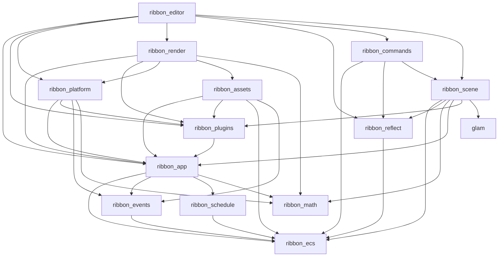

# Ribbon Engine Architecture

The workspace is organized as a small engine core, optional plugins, sample
applications, and the STUDS game. Engine crates do not depend on game code.
`tools/allowed_deps.toml` is the machine-checked source for direct dependency
policy; run `python tools/check_deps.py` after changing a manifest.

## Repository layout

| Path | Contents | Package prefix |
| --- | --- | --- |
| `crates/` | Ribbon Engine core: foundations, runtime, scene and rendering contracts, editor | `ribbon_*` |
| `plugins/` | Optional domain behavior installed into an `App` | `ribbon_plugin_*` (feature directories stay concise, such as `plugins/physics`) |
| `examples/` | Small engine-only applications built on the ECS engine | none |
| `games/` | Games composed from the engine and plugins | none |
| `docs/`, `tools/`, `assets/` | Plans and decisions, dependency policy tooling, engine sample assets | |

The deprecated `engine/` compatibility tree has been removed after moving the final STUDS test and
benchmark imports to their canonical packages. `tools/check_deps.py` rejects any reintroduction of
the retired `voxelworks-*` packages or engine-to-game dependency edges.

## Dependency graph

Arrows point from a crate to what it may depend on (the full allowlist is in
`tools/allowed_deps.toml`). Plugins and examples sit above this graph and
depend only on `ribbon_*` crates and, where listed, on other plugins.

## Which rendering crate is which

The names are close, so for the record:

| Package | Role |
| --- | --- |
| `ribbon_render` | Backend-neutral frame/draw contracts, resource-validated render graph, CPU presenter and optional wgpu context. Owns no scene knowledge. |
| `ribbon_plugin_rendering` | Legacy voxel scene/material data, the supported CPU raycaster, and a CPU-only ECS bridge. It no longer exposes a GPU raycaster or `RenderBackend` selector. |
| `ribbon_plugin_render3d` | Native-surface indexed/instanced mesh renderer with ECS extraction, depth buffering, metallic-roughness PBR, HDR tone mapping, directional and one spotlight shadow map (3x3 PCF), up to eight point lights, glTF base/normal/AO/emissive maps, exponential fog, bloom, frustum culling, greedy voxel mesh support, dynamic GPU mesh eviction and `OffscreenVoxelRenderer`. |

## Layers and responsibilities

| Layer | Packages | Does not do |
| --- | --- | --- |
| Foundations | `ribbon_math`, `ribbon_ecs`, `ribbon_events`, `ribbon_schedule` | Platform I/O, rendering, or gameplay |
| Runtime | `ribbon_app`, `ribbon_plugins`, `ribbon_platform`, `ribbon_assets` | Game-specific rules or GPU scene extraction |
| Scene and rendering contracts | `ribbon_reflect`, `ribbon_scene`, `ribbon_render`, `ribbon_commands`, `ribbon_editor` | Game assets, gameplay, or automatic parallelism |
| Plugins | `ribbon_plugin_voxel`, `ribbon_plugin_physics`, `ribbon_plugin_animation`, `ribbon_plugin_audio`, `ribbon_plugin_rendering`, `ribbon_plugin_editor_tools` | Owning the app loop or game state |
| Applications | `examples/*`, `games/studs` | Being dependencies of engine crates |

The permitted package edges are listed in `tools/allowed_deps.toml`. Math and
ECS are leaves; schedule/events build on ECS; app builds on those foundations;
platform, assets, scene, and rendering build on app contracts; plugins add
reusable domain behavior; games compose plugins. Dependency policy is checked against every Cargo dependency class (normal, build, dev, and
optional). In addition to explicit allowlist edges, `tools/check_deps.py` enforces owner-layer rules:
engine crates depend only on engine crates; plugins depend on engine crates/other plugins; examples
depend on engine crates/plugins; games depend on engine crates/plugins; no workspace package depends
on a game. This catches forbidden edges even if someone tries to add them to the allowlist.

## Frame order and plugins

`App::update` advances `Time`, then runs `First`, `PreUpdate`, zero or more
`FixedUpdate` steps, `Update`, `PostUpdate`, `Render`, and `Last`, in that
order. The fixed-step loop is capped at eight steps per frame. `Startup` and
`Shutdown` run once. Headless runs use a virtual 60 Hz delta.

Plugins are added in dependency order. Adding a plugin validates its declared
dependencies and unique name, calls `build`, and records it in `Plugins`;
`finish` hooks run when the app is built. The scheduler preserves deterministic
stage ordering: legacy systems run as exclusive barriers while compatible,
access-declared systems may run in conflict-free batches. A plugin should declare
its dependencies, install resources, and register systems in the appropriate stages.

## Writing a plugin or game

A plugin implements `ribbon_plugins::Plugin`, names its required plugins, and
adds reusable engine behavior. A game owns its content and gameplay, installs
the needed plugins, and adds game-specific systems or a compatibility bridge.
Keep dependencies from engine/plugin packages to game packages out of the
workspace.

## Current limits and migration state

- `ribbon_schedule` now supports access-declared parallel callbacks alongside legacy exclusive `&mut World` systems. It validates declarations, builds deterministic conflict-free batches, exposes the plan, and retains a serial fallback. Structural world mutations and conditional systems remain barriers; the metadata is a caller contract rather than compile-time filtering. Target-side compile/runtime checks and serial-vs-parallel comparisons remain pending. See `docs/ACCESS_DECLARED_PARALLEL_SCHEDULER.md`.
- `ribbon_render` profiles CPU graph/frame time, optionally collects asynchronous wgpu timestamp samples for the 3D shadow/mesh work, and tracks estimated GPU resource categories. `ribbon_plugin_render3d` uses generation-checked mesh/material handles and transient HDR target leases with a cache budget in both window and offscreen renderers; estimates are not actual VRAM readings. See `docs/GPU_RESOURCE_LIFETIME_PROFILING.md`.
- `ribbon_assets` supports worker-backed source IO/CPU decode through `request` / `request_ref`, bounded request/completion queues, lifecycle events, strong `AssetRef<T>` leases, and generation-safe eviction. Legacy synchronous `load` and weak `Handle<T>` remain available; auto-eviction is opt-in. For `AssetPlugin` and asynchronous-request users, hot-reload timestamp polling remains on the server thread, while changed-file reads and CPU decoding run on workers; direct synchronous-only users can retain immediate reload behavior. Request priority, cancellation, progress, and byte-budget/LRU policies remain future work. The `graphics_showcase --stress-grid` / `--stress-cycle-frames` workflow exercises repeated placements, CPU asset eviction/reload, GPU-cache release/re-upload, and instance-buffer hysteresis; it is a bounded one-model stress harness, not full world streaming. See `docs/ASSET_LIFETIME_STREAMING.md` and `docs/ASSET_LIFETIME_LARGE_SCENE_STRESS.md`.
- The render graph validates named-resource dependencies and orders native window frame passes. CPU node timings are available through `run_frame_profiled`; the optional GPU timestamp profiler currently covers the 3D shadow/mesh interval, not every graph node. The graph is not a general transient-resource allocator and does not perform within-frame resource aliasing. The opt-in `RenderProfilePlugin` captures bounded post-warmup samples and writes normalized CSV on shutdown; `tools/render_profile_report.py` emits Markdown distribution/pass summaries and can compare P95 values. See `docs/GPU_RESOURCE_LIFETIME_PROFILING.md` and `docs/PERFORMANCE_BASELINES.md`.
- `ribbon_plugin_voxel::ChunkedVoxelWorld` owns edit revisions, dirty chunk invalidation and incremental greedy remeshing. `ribbon_plugin_render3d::OffscreenVoxelRenderer` consumes those updates and uploads/releases chunk GPU meshes; the native ECS `Render3dPlugin` path also releases voxel meshes removed from the extracted scene. STUDS' GPU backend uses the offscreen mesh renderer bridge, while the CPU raycaster remains the deterministic reference/fallback. The legacy GPU raycaster implementation, feature, shaders, ECS route, and parity test have been retired. See `docs/DYNAMIC_VOXEL_WORLD_MIGRATION.md` and `docs/LEGACY_RAYCASTER_RETIREMENT.md`.
- `WinitRunner` must create the `softbuffer` CPU presenter only after `WindowFrame`
  contains a complete non-empty image. `PlatformPlugin` registers the resource for every
  app, including GPU-only apps; resource presence alone must not create a CPU surface for
  an HWND already used by `wgpu`, because competing native surfaces can crash on shutdown.
- The editor has no text input and is compiled only with its `editor` feature
  in debug builds. The glyph table limits available UI characters.
- Local 2D/voxel transforms and 3D quaternion transforms share the same entity hierarchy. `ribbon_scene` snapshots local transforms and parent links, invalidates changed branches plus descendants, reuses cached globals for clean ancestors, and only writes changed global components. Public mutable fields mean detection still requires an O(N) snapshot scan each `PostUpdate`; this is an incremental-composition milestone, not a claim of sublinear update cost. See `docs/TRANSFORM_INVALIDATION.md` and `docs/SCALABILITY_ROADMAP.md`. `ribbon_plugin_render3d` consumes `GlobalTransform3D`.
- `examples/scene_hierarchy_3d` demonstrates this `Transform3D` parent-child composition in the GPU mesh renderer and reports runtime diagnostics for global transform propagation.
- STUDS uses `ribbon_app::App`, `WinitRunner`, and the platform/scene/rendering/audio/game
  plugins. Live gameplay uses `MazeResource` and `RunState` resources plus `Player`, `Enemy`,
  and `PagePickup` entities, advanced by dedicated schedule systems. `Game` remains a
  compatibility/domain facade rather than a runtime resource. Its GPU route invokes
  `ribbon_plugin_render3d::OffscreenVoxelRenderer`, with pixels read back through `WindowFrame`;
  `--renderer cpu` remains the deterministic reference/fallback. STUDS owns no engine
  remeshing or GPU-resource policy. Manual gameplay verification on target Windows hardware remains
  required for final visual acceptance; the compatibility-tree migration itself is complete in
  [`docs/PHASE9.md`](docs/PHASE9.md).
- `examples/horror_slice` is a native-surface visual acceptance example. Its `room.ron` describes one concrete room, door/key placements, a lantern save-point prop, monster spawn/path data, and AABB colliders. The player can move with WASD and look with the mouse; `ribbon_plugin_physics::slide_capsule_xz` provides reusable static-AABB capsule sliding, while the example owns its first-person input/camera system. Door/key interaction, skeletal animation, positional audio, and save logic remain later phases. Bundled GLBs contain the downloaded Poly Haven CC0 maps; separately marked procedural placeholders remain available as fallbacks.
- The neutral CPU renderer fixture/golden remains under `plugins/rendering/tests/`. The obsolete CPU-versus-legacy-GPU parity test was removed together with that GPU backend; `plugins/rendering/tests/legacy_gpu_backend_retired.rs` now guards the retirement boundary, while `plugins/render3d/src/offscreen.rs` has a GPU-adapter-dependent mesh lifecycle integration test.
- `examples/voxel_mesh_showcase` demonstrates dynamic block edits, chunk-boundary invalidation and GPU mesh replacement on the native mesh pipeline. Dynamic editing is provided by `ChunkedVoxelWorld::set_block` and `rebuild_dirty_chunks`; STUDS exercises GPU upload/update/eviction through `OffscreenVoxelRenderer`.

See `docs/DECISIONS.md` for choices made where the refactor plan left behavior unspecified,
`docs/SCALABILITY_ROADMAP.md` for future scaling work, `docs/ARCHITECTURE_REFACTOR_CLOSEOUT.md`
for the cleanup/verification record, `docs/PHASE9.md` for the legacy-tree retirement record, and
`docs/LEGACY_ARCHITECTURE.md` for historical renderer-migration verification results.

## 3D Rendering

- The mesh renderer uses `GpuWindowPlugin` for direct native wgpu-surface presentation. The GPU window builds a `RenderGraph` chain for surface clearing, registered `FramePass` instances, and final presentation ordering. `Render3dPlugin` extracts camera, global mesh/model/voxel transforms, and sunlight into `ExtractedScene3D` during `PostUpdate`; its frame pass consumes that snapshot during GPU submission.
- `ribbon_plugin_render3d` currently includes a first Cook-Torrance/GGX metallic-roughness shader, a directional shadow-depth pass, a `Rgba16Float` HDR target and Reinhard tone mapping. It samples glTF base-color and packed metallic-roughness textures. Frustum culling applies to the color pass while off-screen models remain eligible for shadow casting. Cascaded/soft shadows, normal/occlusion/emissive maps, alpha modes, AO, bloom, fog, IBL and GPU culling remain unimplemented.
- `ribbon_plugin_voxel::greedy_mesh_chunk` creates material-grouped surface meshes with cross-chunk face culling and converts Z-up voxel coordinates to Y-up mesh coordinates. `examples/voxel_mesh_showcase` proves this path on the native renderer; STUDS GPU mode now uses `ribbon_plugin_render3d::OffscreenVoxelRenderer`; its CPU raycaster remains a reference/fallback.
