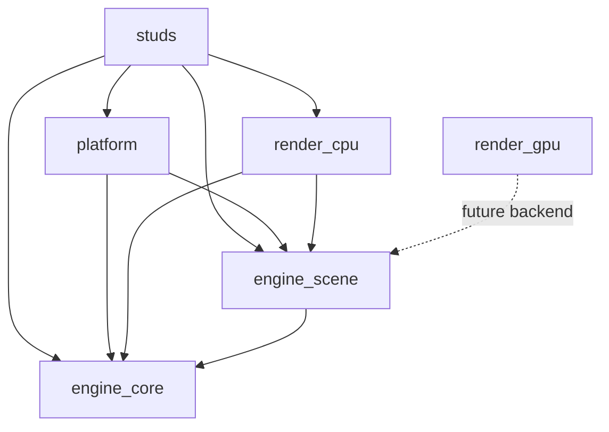

# Workspace architecture

## Crate responsibilities

- `engine_core`: math, voxel storage/casting, physics, input, timing, audio logic, application context, and framebuffer drawing primitives. It has no external dependencies.
- `engine_scene`: renderer-independent `Scene`, `Camera`, `LightingParams`, entity instances/registry, materials, procedural textures, render style, and the `App`/`Renderer` contracts. It depends only on `engine_core`.
- `render_cpu`: reference raycaster, entity intersection, lighting, material shader hooks, post-processing, and Rayon parallelism. It depends on `engine_core` and `engine_scene`.
- `render_gpu`: empty backend skeleton for a future wgpu implementation. It has no dependencies and is not a default member.
- `platform`: desktop window, input, cursor, audio output, event loop, and presentation. Its runner accepts any `engine_scene::Renderer` implementation; the platform crate does not select a rendering backend.
- `studs`: game rules, levels, game-specific material shading, UI, and composition of the CPU renderer with the desktop platform.

`default-members` stays `studs`, so root `cargo run` behavior remains the same.

## Dependency rules

1. Keep `engine_core` free of renderer, desktop, and external crates.
2. Keep `engine_scene` plain data and contracts. Do not put function pointers, closures, trait objects, Rayon, or OS/GPU handles in `Scene` or its entity/material data.
3. Put pixel loops, intersection algorithms, shading code, and backend-specific caches in renderer crates.
4. Keep platform code generic over the `Renderer` trait. A platform must not choose a graphics backend.
5. Game-specific albedo rules that are not yet described by `MaterialTable` remain in the CPU `SurfaceShader` implementation; do not move executable shading callbacks into `Scene`.
6. Do not add dependencies to `engine_core` or `engine_scene` without updating the CI dependency-boundary check.

## Decisions

- The temporary `blocks_engine` facade was used only while packages moved. It was removed in phase five; consumers now name `engine_core`, `engine_scene`, or `render_cpu` directly.
- `App` lives in `engine_scene`, not `engine_core`, because its `scene()` method returns a scene type. This keeps the dependency direction from core toward scene from reversing.
- `Scene` borrows its `VoxelWorld` and `EntityRegistry`, while its camera, lighting settings, and entity instances are owned plain data. Built-in and custom registry definitions use static box slices.
- The registry stores phase sway as box data. The CPU resolver applies sway and the page's bob/rotation from `EntityInstance::params`, preserving the former per-frame transforms without callbacks in the scene.
- `Renderer` lives in `engine_scene`. `platform::run` accepts a renderer generic instead of depending on `render_cpu`; this keeps backend selection with the application.
- `App::materials()` supplies the data table separately from `Scene`, matching `Renderer::render_world(scene, materials)`. Its default is an empty static table for apps without custom materials.
- Framebuffers are opaque 24-bit pixels with no alpha channel. To retain existing UI output, the runner copies the rendered world into the overlay framebuffer before the app draws over it. The CPU renderer then stores that flattened image byte-for-byte.
- The Classic and Moody golden tests stayed unchanged and passed at every phase; no golden values were re-blessed.
- The CPU `SurfaceShader` remains renderer-side. `MaterialTable` records the block albedo rule and texture kind/seed, while exact procedural material math stays in the existing CPU shader until it can be expressed and ported without changing pixels.

## GPU port blockers

The GPU crate is only a skeleton. A real backend still needs equivalents for the CPU voxel DDA and `face_ao`, entity box intersection and phase transforms, flashlight/fog equations, `StudsSurface`'s hit-coordinate and cell-hash albedo formulas, procedural texture filtering/fade, tone mapping and display gamma, palette lookup, vignette, frame grain, and Bayer dithering. Entity point appearance is also currently provided by CPU `SurfaceShader::entity_surface`; it must become data or a renderer-side material rule before entities can be shaded on a GPU.

See [`render_gpu/shaders/README.md`](render_gpu/shaders/README.md) for the rendering-stage checklist.
