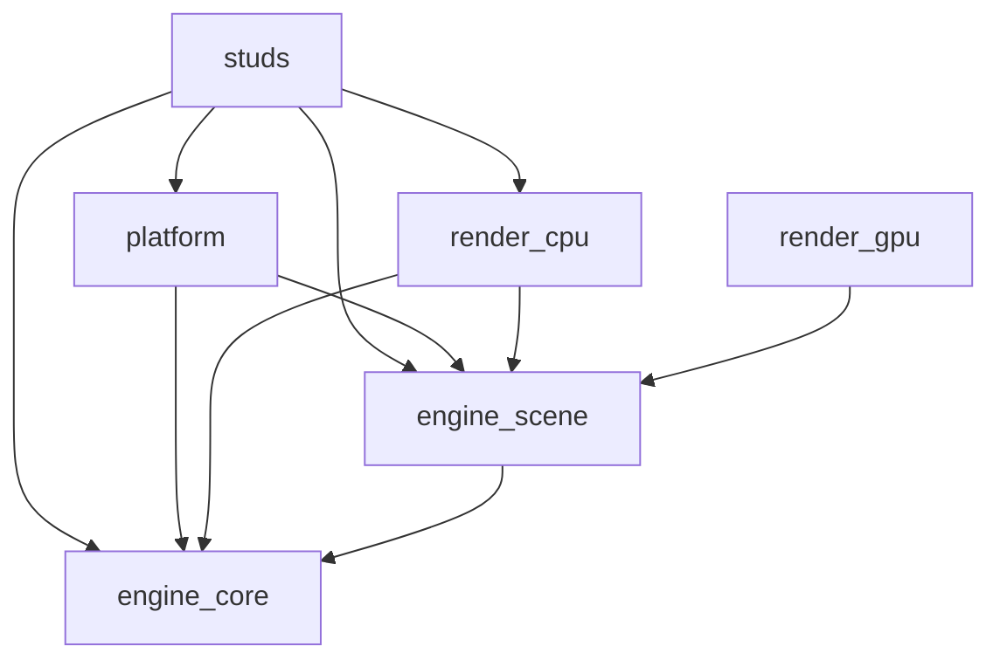

# Workspace architecture

## Crate responsibilities

- `engine_core`: math, voxel storage/casting, physics, input, timing, audio logic, application context, canvas primitives, framebuffer drawing, and ordered draw lists. It has no external dependencies.
- `engine_scene`: renderer-independent `Scene`, `Camera`, `LightingParams`, entity instances/registry, materials, procedural textures, render style, and the `App`/`Renderer` contracts. It depends only on `engine_core`.
- `render_cpu`: reference raycaster, entity intersection, lighting, material shader hooks, post-processing, and Rayon parallelism. It depends on `engine_core` and `engine_scene`.
- `render_gpu`: wgpu backend under development; CPU renderer remains the reference/fallback.
- `platform`: desktop window, input, cursor, audio output, event loop, and presentation. Its runner accepts any `engine_scene::Renderer` implementation; the platform crate does not select a rendering backend.
- `studs`: game rules, levels, game-specific material shading, UI, and composition of the CPU renderer with the desktop platform.

`default-members` stays `studs`, so root `cargo run` behavior remains the same.

## Dependency rules

1. Keep `engine_core` free of renderer, desktop, and external crates.
2. Keep `engine_scene` plain data and contracts. Do not put function pointers, closures, trait objects, Rayon, or OS/GPU handles in `Scene` or its entity/material data.
3. Put pixel loops, intersection algorithms, shading code, and backend-specific caches in renderer crates.
4. Keep game and scene data renderer-agnostic. The platform runner owns the GPU presenter and CPU fallback selection.
5. Game-specific albedo rules that are not yet described by `MaterialTable` remain in the CPU `SurfaceShader` implementation; do not move executable shading callbacks into `Scene`.
6. Do not add dependencies to `engine_core` or `engine_scene` without updating the CI dependency-boundary check.

## Decisions

- A `FramePlan` describes one frame as an optional scene, ordered world layer, brightness factor, and ordered UI layer. This preserves the former world/HUD -> brightness -> UI order.
- `Canvas` is the shared 2D drawing API. `Framebuffer` is the immediate CPU target, while `DrawList` stores typed rectangle, text, dim, and built-in effect commands for deferred backends. The 5x7 glyph table is public data in `engine_core` and remains the sole font source.

- The temporary `blocks_engine` facade was used only while packages moved. It was removed in phase five; consumers now name `engine_core`, `engine_scene`, or `render_cpu` directly.
- `App` lives in `engine_scene`, not `engine_core`, because its `scene()` method returns a scene type. This keeps the dependency direction from core toward scene from reversing.
- `Scene` borrows its `VoxelWorld` and `EntityRegistry`, while its camera, lighting settings, and entity instances are owned plain data. Built-in and custom registry definitions use static box slices.
- The registry stores phase sway as box data. The CPU resolver applies sway and the page's bob/rotation from `EntityInstance::params`, preserving the former per-frame transforms without callbacks in the scene.
- `Renderer` lives in `engine_scene`. `platform::run` accepts a renderer generic instead of depending on `render_cpu`; this keeps backend selection with the application.
- `App::materials()` supplies the data table separately from `Scene`, matching `Renderer::render_world(scene, materials)`. Its default is an empty static table for apps without custom materials.
- The desktop runner selects GPU presentation by default, with `--renderer cpu` as a reference fallback and `--renderer gpu` as a required-GPU mode. The GPU world pass consumes `FramePlan` directly, so it does not read a CPU framebuffer back during ordinary presentation.
- Framebuffers are opaque 24-bit pixels with no alpha channel. To retain existing UI output, the runner copies the rendered world into the overlay framebuffer before the app draws over it. The CPU renderer then stores that flattened image byte-for-byte.
- The Classic and Moody golden pixel values remain pinned. Realistic material sets are plain RGBA mip-chain data in `engine_scene`; `studs` loads the processed raw maps and assigns stable material/texture IDs.
- The CPU and GPU renderers both sample Realistic albedo, normal, roughness, and AO maps. The CPU uses wrapped bilinear/trilinear sampling, while the GPU packs the same mip levels into a storage buffer and samples them in WGSL. These paths have deterministic CPU golden coverage and a manually launchable GPU preview; exact CPU/GPU parity and integrated-GPU 1080p performance are not yet measured.
- `studs` owns image conversion and runtime asset loading. Missing or malformed material data falls back to the procedural shader and logs a warning; the scene crate contains no file, image-decoder, or GPU APIs.

## Phase 2: desktop and GPU presentation

- Desktop uses winit 0.30.13 and wgpu 25.0.2. The presenter uses nearest-neighbor WGSL upscale and centered aspect-fit bars.
- GPU is the default. `--renderer cpu` or `STUDS_RENDERER=cpu` selects the CPU reference; `--renderer gpu` requires an adapter; the default `auto` mode falls back to softbuffer when GPU setup fails.
- Winit owns keyboard, mouse buttons, scroll, focus, resize, and window events; mouse look consumes raw device deltas, preferring Locked cursor grab and falling back to Confined plus recenter.

### Manual platform smoke checklist

- Launch the desktop app and confirm the internal image is nearest-upscaled with centered letterbox bars.
- Walk, look, pause, adjust a setting that requests a new size, and close the window.
- Confirm a missing GPU adapter reports a fallback message and the software presenter continues running.

## Phases 3–5: GPU rendering and verification

- `world.wgsl` performs voxel DDA, entity-box intersections, face AO, built-in STUDS materials and procedural textures, flashlight/fog, tone/gamma/palette mapping, vignette, grain, and Bayer dithering. World voxels and entity instances are packed into storage buffers; textures and targets persist between frames.
- The frame order is GPU world, ordered HUD/effects, brightness, UI, then nearest presentation. Rectangles are instanced; text uses pixels from the shared 5x7 glyph table.
- GPU mode skips CPU world rendering. `render_cpu` remains the reference and fallback. `studs/examples/gpu_preview.rs` starts a deterministic Game::new(42) world directly for manual GPU/CPU comparison.
- The GPU shader is exercised by launching the deterministic preview on the local adapter. Headless CPU/GPU readback parity thresholds and GPU timings have not yet been established; the CPU render benchmark does not measure the GPU path.

## Realistic materials

- Four CC0 Poly Haven sets (two walls, floor, ceiling) are processed to 256×256 RGBA8 map sidecars plus reproducible ZIP archives. `tools/fetch_assets.py --check` verifies manifest fields, allowed licenses, archive digests/content, sidecars, and the 40 MiB shipped-assets cap; CI runs this check.
- Realistic shading is enabled by the Realistic visual style and High/Realistic quality presets. Low and Medium skip PBR texture sampling. The saved reduce-flashing setting is present in the UI, but proximity-driven flashing effects are not implemented yet.
- The built-in monster is still box geometry. No candidate model has yet met the realistic humanoid, animation, redistribution-license, and glTF requirements, so no sprite baking or animated monster rendering is claimed.
