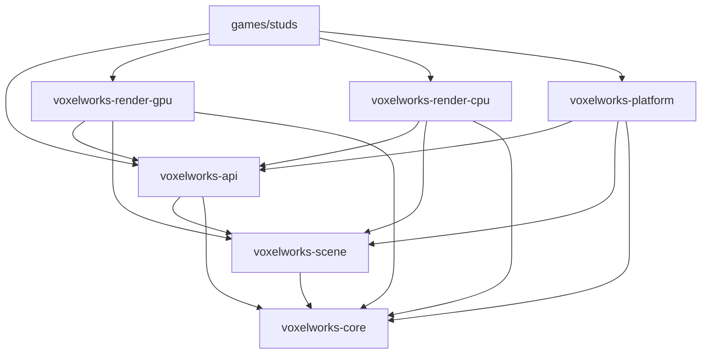

# Voxelworks Engine

Voxelworks is a reusable Rust engine for rendering voxel scenes. GPU rendering is the primary path; the CPU renderer remains a reference backend and fallback. The separate [`studs`](games/studs/) game demonstrates how an application supplies content and rules.

## Crates

| Crate | Responsibility |
| --- | --- |
| `voxelworks-core` | Math, voxel data and queries, physics, input, timing, and audio identifiers. No dependencies. |
| `voxelworks-scene` | Renderer-neutral scene, entity, material, texture, and style data. |
| `voxelworks-api` | The single app, frame, drawing, framebuffer, and renderer contract. |
| `voxelworks-render-gpu` | Primary wgpu renderer, offscreen readback, and window presenter. |
| `voxelworks-render-cpu` | Software reference raycaster, rasterizer, font, and post-processing. |
| `voxelworks-platform` | Window, input, audio playback, and the application runner. GPU and audio are optional features. |
| `voxelworks-testkit` | Neutral engine-only scenes used by renderer tests; dev-only. |



The engine-only example does not depend on the game:

```sh
cargo run -p voxelworks-minimal -- --renderer gpu
cargo run -p voxelworks-minimal -- --renderer cpu
cargo run -p voxelworks-minimal -- --headless --renderer gpu
cargo run -p voxelworks-minimal -- --headless --renderer cpu
```

Headless mode prints a framebuffer checksum. GPU and audio features are enabled by default in the example; build with `--no-default-features` for CPU-only and silent mode.

## What an application supplies

- An `App` implementation and its update/frame-plan logic.
- Entity definitions, bounds, and an entity registry.
- A material table, sprite atlas or PBR texture data as needed, and render styles.
- CPU `SurfaceShader` behavior when using the reference renderer. GPU appearance must be represented by shared material/scene data.
- An audio bank when the application uses platform audio.

See [ARCHITECTURE.md](ARCHITECTURE.md) for layering rules, known limits, and measured CPU/GPU parity. See [CONTRIBUTING.md](CONTRIBUTING.md) before adding code.
