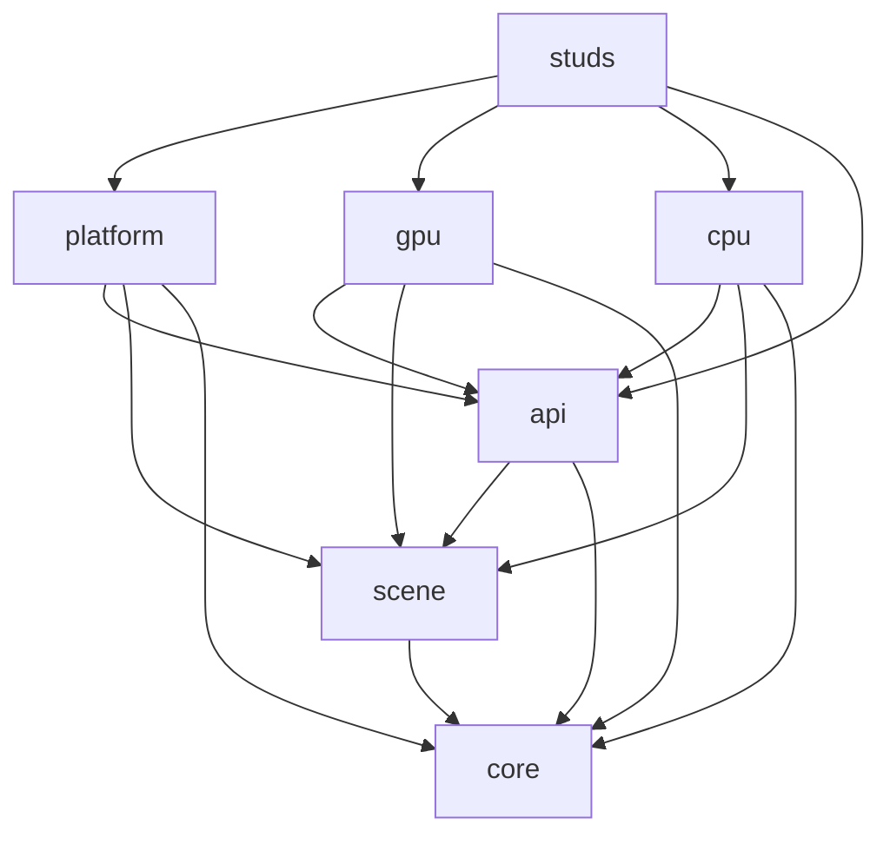

> **Historical archive.** The `voxelworks-*` packages and `engine/crates/` paths described below
> belonged to the pre-Phase-9 workspace and have been removed. This file preserves old renderer
> measurements and migration context only; do not copy its package paths, build commands, or dependency
> descriptions into new code. The supported architecture is documented in [`ARCHITECTURE.md`](../ARCHITECTURE.md).

# Legacy architecture (pre-Phase 9)

## Dependency layers

The engine code follows a strict downward dependency direction. Arrows point from a consumer to its dependency.

`voxelworks-core` contains only math, voxel data and queries, physics, time, input, and audio IDs/bank descriptors. Originally dependency-free, it is now a compatibility facade that re-exports `ribbon_math`, `ribbon_plugin_voxel`, `ribbon_plugin_physics`, `ribbon_app::time`, `ribbon_platform::input` and the `ribbon_plugin_audio` bank descriptors (see `SHIMS.md`). `voxelworks-scene` contains plain renderer-neutral world, camera, entity, material, texture, and style data. `voxelworks-api` is the sole owner of the app/frame/renderer contracts, draw lists, and plain framebuffer storage. No engine crate depends on a game.

The platform enables `gpu` and `audio` by default. Both are optional features; `voxelworks-platform --no-default-features` uses the CPU renderer and omits audio playback. `voxelworks-render-gpu` is the primary rendering path (its implementation has since moved to `ribbon_plugin_rendering::gpu::voxel`; the crate is now a re-export shim). `voxelworks-render-cpu` owns software raycasting, rasterization, font drawing, and post-processing and serves as the reference and fallback.

## Code placement rules

- Put portable math, voxel storage/queries, physics, input/time primitives, and audio identifiers in `core`.
- Put scene and material descriptions in `scene`; do not place callbacks, OS/GPU handles, or renderer caches there.
- Put app, frame, draw, and renderer contracts in `api`, with one definition per contract.
- Put software drawing and CPU-only shading in `render-cpu`; GPU pipelines and buffers belong in `render-gpu`.
- Put windows, device input, audio playback, and app lifecycle in `platform`.
- Put game rules, levels, assets, and content-specific presets in `games/studs`.

CI enforces direct dependency edges with `tools/check_deps.py` (allowlist in `tools/allowed_deps.toml`), checks that `core`, `scene`, `api` and `platform` do not compile `wgpu`, `rodio` or `rayon` unless the matching feature is enabled, and scans engine source for game-specific vocabulary.

## Assets

Only processed runtime assets and their credits/licenses are committed. Raw third-party archives and authoring sources are fetched on demand from URLs with SHA-256 checks in the game manifest and stay ignored under `games/studs/assets/source/`. `python games/studs/tools/fetch_assets.py --check` verifies the manifest, hashes, archive/source policy, and size limits.

## Renderer verification

The neutral fixture (formerly `voxelworks-testkit`, now `plugins/rendering/tests/common/mod.rs`) provides a small engine-owned room with two materials, one box entity, one billboard entity, and a generated sprite atlas. It has no dependency on game assets. CPU goldens cover three styles plus draw layers, a fullscreen effect, brightness, entity rendering, and UI text. Their FNV-1a frame hashes are `c0aa91941785e603`, `6666e2333fc5196c`, and `3260fd9f7e087f2e`.

The CPU/GPU parity integration test renders those same three frame plans through `GpuRenderer` readback. On the local Windows adapter, the measured mean absolute RGB-channel errors were 0.0000, 0.3841, and 0.6895 (8-bit channel units); maximum channel errors were 0, 1, and 2. The assertions allow mean error up to 1.0 and maximum error up to 3 to tolerate small backend floating-point differences. The test prints `SKIP` and its reason when no adapter exists. Linux CI installs Mesa Vulkan software drivers and runs the parity test explicitly (`cargo test -p ribbon_plugin_rendering --test parity`).

The minimal example runs CPU or GPU interactively or headlessly, and prints an image checksum in headless mode. CPU and GPU checksums are expected to differ slightly due to backend arithmetic.

## Known limitations

- `SurfaceShader::albedo` and `SurfaceShader::entity_surface` are CPU-only extension hooks. GPU appearance must be expressed through `MaterialTable` and shared sprite/PBR data. An ignored test in the GPU crate explicitly names the unsupported CPU-only callback appearance.
- Parity is measured only on the neutral fixture and the current adapter/software Vulkan CI path. It does not guarantee pixel identity for every game-specific style/material combination or establish 1080p performance.
- The GPU renderer currently enforces the exported limits for draw quads, render passes, PBR texture sets/maps, entities, and entity boxes; scenes exceeding them return descriptive errors.
