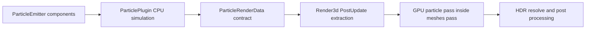

# Engine particles

`ribbon_plugin_particles` simulates emitters on the CPU in `Stage::Update` and writes batches of plain data to `ParticleRenderData`. `ribbon_plugin_render3d` extracts that data and draws it in the existing HDR mesh pass. The contracts crate contains only particle enums, instances, batches, and the frame resource.

## API

- `ParticleEmitter` defines rate, bursts, shape, simulation space, lifetime, velocity, size/color curves, forces, ground response, render blend/shape, and deterministic seed.
- `ParticlePlugin` installs `ParticleBudget`, `ParticleDiagnostics`, and the `ParticleRenderData` resource, then updates each emitter.
- `Pcg32` provides repeatable sampling without a global random source.
- `ParticleRenderData.batches` contains one batch per emitting entity. World particles retain their spawn pose; local particles follow the emitter's current transform. Emitter scale is ignored.
- `ParticleEmitter::rain()`, `snow()`, `fire()`, `smoke()`, `sparks()`, and `dust()` provide authored presets. ATHAR attaches rain to its camera and uses the particle diagnostics count in its HUD.

| Preset | Shape | Typical use |
|---|---|---|
| `rain()` | Box | Camera-centered rain streaks; 147 particles/s, up to 512 |
| `snow()` | Sphere | Slow sparse snowfall |
| `fire()` | Cone | Additive warm flame |
| `smoke()` | Sphere | Expanding alpha smoke |
| `sparks()` | Point | Short additive streaks with gravity and ground response |
| `dust()` | Sphere | Short lived diffuse dust |

The simulator clamps `Time.delta` to 0.1 seconds, caps emitters at 100,000 particles, and uses a default global budget of 200,000. Alpha sorting is exposed in the batch contract and is limited to 20,000 instances per batch in the renderer. Extraction takes the batch vector from the simulation resource; the simulation reuses its resource and instance capacities where available.

## Not implemented

Textured sprites/flipbook atlases, soft particles or depth fade, GPU compute simulation, sub-emitters, trails/ribbons, mesh particles, lighting/shadows on particles, fog on particles, collision with physics colliders, and editor reflection of `ParticleEmitter` are not implemented. There is no particle frustum culling. Rendered GPU output and ATHAR's rain appearance need manual visual verification on a supported adapter.
