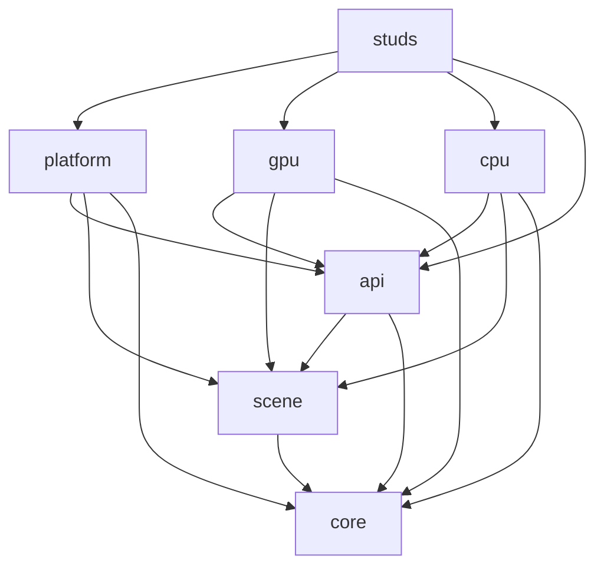

> **Historical archive.** The `voxelworks-*` packages and `engine/crates/` paths described below
> belonged to the pre-Phase-9 workspace and have been removed. This file preserves old renderer
> measurements and migration context only; do not copy its package paths, build commands, or dependency
> descriptions into new code. The temporary `studs_cpu_renderer::gpu::voxel` renderer and its
> CPU/GPU parity test documented later in this file have since been deleted; those old hashes and
> commands are historical only and do not describe the current mesh renderer. The supported architecture
> is documented in [`ARCHITECTURE.md`](../architecture/ARCHITECTURE.md).

# Legacy architecture (pre-Phase 9)

## Dependency layers

The engine code follows a strict downward dependency direction. Arrows point from a consumer to its dependency.

`voxelworks-core` contains only math, voxel data and queries, physics, time, input, and audio IDs/bank descriptors. Originally dependency-free, it is now a compatibility facade that re-exports `ribbon_math`, `studs_voxel`, `ribbon_plugin_physics`, `ribbon_app::time`, `ribbon_platform::input` and the `ribbon_plugin_audio` bank descriptors (see `SHIMS.md`). `voxelworks-scene` contains plain renderer-neutral world, camera, entity, material, texture, and style data. `voxelworks-api` is the sole owner of the app/frame/renderer contracts, draw lists, and plain framebuffer storage. No engine crate depends on a game.

At this historical snapshot, the platform enabled `gpu` and `audio` by default, and `voxelworks-render-gpu` was described as the primary rendering path. That old backend was temporarily moved to `studs_cpu_renderer::gpu::voxel` and has since been deleted. The current GPU mesh path is owned by `ribbon_plugin_render3d`; the retained `studs_cpu_renderer::cpu` implementation provides software voxel rendering and its CPU-only shading hooks. Do not use this paragraph as current feature or package guidance.

## Code placement rules

- Put portable math, voxel storage/queries, physics, input/time primitives, and audio identifiers in `core`.
- Put scene and material descriptions in `scene`; do not place callbacks, OS/GPU handles, or renderer caches there.
- Put app, frame, draw, and renderer contracts in `api`, with one definition per contract.
- Put software drawing and CPU-only shading in `render-cpu`; GPU pipelines and buffers belong in `render-gpu`.
- Put windows, device input, audio playback, and app lifecycle in `platform`.
- Put game rules, levels, assets, and content-specific presets in `games/studs`.

CI enforces direct dependency edges with `tools/check_deps.py` (allowlist in `tools/allowed_deps.toml`), checks that `core`, `scene`, `api` and `platform` do not compile `wgpu`, `rodio` or `rayon` unless the matching feature is enabled, and scans engine source for game-specific vocabulary.

## Assets

Only processed runtime assets and their credits/licenses are committed. Raw third-party archives and authoring sources are fetched on demand from URLs with SHA-256 checks in the game manifest and stay ignored under `games/studs/assets/source/`. `python games/studs/tools/fetch_assets.py --check` verifies the manifest, hashes, archive/source policy, and size limits.

## Renderer verification

The neutral fixture (formerly `voxelworks-testkit`, now `games/studs/crates/studs_cpu_renderer/tests/common/mod.rs`) provides a small engine-owned room with two materials, one box entity, one billboard entity, and a generated sprite atlas. It has no dependency on game assets. CPU goldens cover three styles plus draw layers, a fullscreen effect, brightness, entity rendering, and UI text. Their FNV-1a frame hashes are `c0aa91941785e603`, `6666e2333fc5196c`, and `3260fd9f7e087f2e`.

At that historical stage, a CPU/legacy-GPU parity integration test rendered those same three frame plans through the then-active `GpuRenderer` readback. On the local Windows adapter, the measured mean absolute RGB-channel errors were 0.0000, 0.3841, and 0.6895 (8-bit channel units); maximum channel errors were 0, 1, and 2. The old assertions allowed mean error up to 1.0 and maximum error up to 3 to tolerate small backend floating-point differences. The test and renderer have since been removed; these numbers are archival measurements and are not parity measurements for the current mesh renderer.

The former minimal example ran CPU or GPU interactively or headlessly and printed a checksum. That example and its legacy GPU rendering route are no longer present in the active workspace; these checksum notes are historical only.

## Known limitations

- `SurfaceShader::albedo` and `SurfaceShader::entity_surface` remain CPU-only extension hooks. The new mesh renderer consumes mesh/material/palette data and does not execute those callbacks. Their cross-renderer behavior has not been implemented or verified by this migration.
- The CPU golden and old CPU/legacy-GPU parity measurements above belong to the archived renderer and do not guarantee pixel parity with the current mesh renderer or establish 1080p performance.
- Limits and behavior of the current mesh renderer are documented with `ribbon_plugin_render3d`; the historical limits of the removed raycaster must not be treated as current mesh-renderer contracts.
