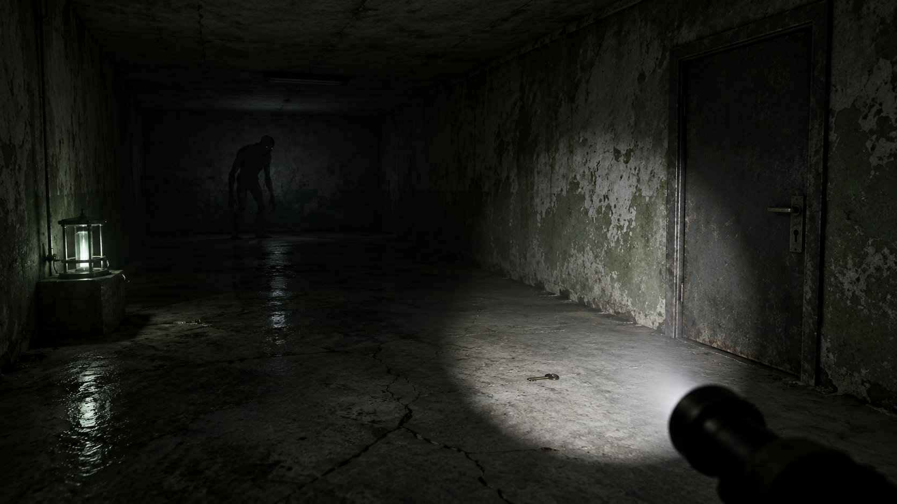

# Horror Slice (single-room visual slice)

This is the native-surface horror acceptance example for Voxelworks. It uses
`GpuWindowPlugin` + `Render3dPlugin`; it does not invoke STUDS or the offscreen/readback
bridge.

## Visual target



This generated concept image is bundled as a layout/lighting target only; it is not loaded or drawn at runtime. The room implementation is intentionally approximated using native mesh rendering and the texture/model assets below. Exact visual parity still requires a fresh Windows GPU screenshot review after these lighting/material corrections.

## Current visual content and controls

- One enclosed, hand-authored concrete room from `assets/room.ron` with cracked/damp wall
  and floor materials, a low ceiling, and one closed metal exit door with visible lock hardware.
- Native first-person camera with WASD movement, mouse look, Shift sprint, mouse capture,
  Escape to release the pointer, and left-click to recapture it. The camera moves at a fixed
  eye height and collides against the room's authored AABB colliders, including wall sliding;
  collision math is a reusable `plugin_physics::slide_capsule_xz` helper.
- Flashlight spotlight and perspective shadow map follow the camera's position and orientation
  every frame. Point lighting/emissive lantern keeps the save point readable, while distance/
  height fog and low fill light preserve a dark horror mood.
- Brass-colored key mesh, save-point lantern/pedestal, and a tall static monster silhouette
  at the far end of the room.
- Embedded glTF models include the nine downloaded Poly Haven CC0 diffuse, AO/roughness/metallic,
  and OpenGL-normal maps. Deterministic procedural PBR maps remain available as fallbacks and are
  marked `PLACEHOLDER` in `assets/asset_manifest.json`.

The generated glTF material indices map diffuse, ARM (AO/roughness/metallic), normal, and emissive slots to their intended embedded images. `plugin_render3d` shares GPU textures across material/model assets when decoded pixels, dimensions, and color-space format match; the profile report separates unique texture mip-chain estimates from material uniform estimates. See [`../../docs/TEXTURE_MATERIAL_MEMORY_AUDIT.md`](../../docs/TEXTURE_MATERIAL_MEMORY_AUDIT.md).

The camera now moves and is constrained by the static room/prop colliders. The door/key are not
interactive yet; the monster is not skeletal-animated or AI-controlled; positional audio and save
serialization remain future phases and are not claimed as implemented.

## Asset streaming

The room queues its distinct glTF models with `AssetServer::request_ref` rather than blocking the startup thread on each decode. The example retains one strong `AssetRef` per distinct room model for the gameplay lifetime, so the weak handles on model instances stay resident even if automatic eviction is enabled by a host application. CPU IO/decode runs on asset workers; `plugin_render3d` remains responsible for GPU uploads on the render thread. Initial-load and hot-reload failures are reported in the console.

## Run

```powershell
cargo run -p horror_slice
```

A bounded smoke run is available:

```powershell
cargo run -p horror_slice -- --frames 120
```

## Texture provenance and replacement

The bundled GLBs currently contain all nine downloaded 1K source maps, whose hashes and
attribution are recorded in the manifest. Procedural `PLACEHOLDER` maps are also kept in the
repository as deterministic fallback assets; they are not represented as Poly Haven photographs.
Recommended CC0 replacements are Poly Haven's [Concrete Wall 003](https://polyhaven.com/a/concrete_wall_003),
[Concrete Floor Damaged 01](https://polyhaven.com/a/concrete_floor_damaged_01), and
[Rusty Metal 02](https://polyhaven.com/a/rusty_metal_02); creator/licence credits are in
[`assets/CREDITS.md`](assets/CREDITS.md).

To refresh the original 1K diffuse, AO/roughness/metallic, and OpenGL-normal maps and regenerate
the embedded GLBs:

```powershell
python tools/fetch_horror_textures.py
python tools/make_test_models.py
python tools/check_deps.py
cargo fmt --check
cargo clippy --workspace --all-targets -- -D warnings
cargo test --workspace -j 1
cargo test --workspace --no-default-features -j 1
cargo run -p horror_slice
```

`plugin_render3d` also includes a headless GPU test that saves
`target/spotlight_corridor.png` and prints the path when a suitable adapter exists;
if no adapter is available, it prints a clear skip message. That screenshot is a test
fixture, not proof that the interactive Windows composition matches the concept art.

## Render profiling capture

Run the example in release mode with a finite frame count to write a CSV report after shutdown.
The default warmup is 120 successfully rendered frames; set `--profile-warmup N` to change it.
For example:

```powershell
cargo run --release -p horror_slice -- --frames 1800 --profile-csv target/profiles/horror-slice.csv
python tools/render_profile_report.py target/profiles/horror-slice.csv --output target/profiles/horror-slice.md
```

Compare runs only on the same machine, GPU adapter, resolution, build profile, scene setup, and
frame-count/warmup settings. GPU timestamps are asynchronous and the current GPU interval covers
shadow plus mesh rendering, not the whole frame. Resource byte counts are estimates, not driver VRAM readings.
